<div align="center">

# ResultRelay

**A policy-governed agent that refuses to call a critical lab result "communicated" until there is evidence a person received it.**
For walk-in laboratories licensed by the Dubai Health Authority: it keeps *sent*, *accepted by the
gateway*, *delivered*, *acknowledged* and *documented* apart, binds every acknowledgment to the current
result version, and refuses another jurisdiction's rule as binding.

`ITU AI for Good Sandbox Hackathon — UAE` · Healthcare track · agent roles: **policy & legal adviser · institutional participants (DHA, TDRA) · multi-agent coordination**


[](https://github.com/Shashwat-srivastav/ResultRelay-UAE/actions/workflows/ci.yml)

-success)

</div>

> ⚠️ **Synthetic data, hackathon exercise only.** No real patient data, EHR, SMS gateway or clinical
> claim. ResultRelay does not diagnose, set thresholds, interpret results or give medical advice.

---

## Team

**Team Aabyss** — submission to the
[ITU AI for Good Sandbox Hackathon — United Arab Emirates](https://aiforgood.itu.int/), healthcare track.

| | |
| :--- | :--- |
| **Team** | Team Aabyss |
| **Leader** | Priya Singh |
| **Members** | Shashwat Srivastava · Divyansh Vishwakarma · Anushka Gupta |
| **Hosts / partners** | ITU · TDRA (Telecommunications and Digital Government Regulatory Authority) |

---

## The one-sentence version

A critical result is flagged, the SMS gateway says "accepted", and a dashboard turns green. Nobody knows
whether the patient has it. **ResultRelay will not close the case on a gateway acceptance, will not reuse
an acknowledgment of version 1 for a corrected version 2, and will not message a patient directly about
a genetic result** — DHA's standard routes those to the referring physician.

```console
$ python run_demo.py 4
── SC-04 [controversial] A generic walk-in rule retrieved for a genetic result  (S4-genetic-scope-exclusion)
   FINAL ESCALATION_REQUIRED              VERDICT VIOLATION              ✓ expected ESCALATION_REQUIRED
   policy-blind final → DELIVERY_CONFIRMED · rules only (no agents) → ESCALATION_REQUIRED
```

## Multi-agent orchestration — LLMs only where reasoning is needed

The design rule: **use a language model only where the problem needs probabilistic reasoning** (reading
policy, reading what people said); decide everything else in code — transport status, revision binding,
idempotency, and whether to escalate.

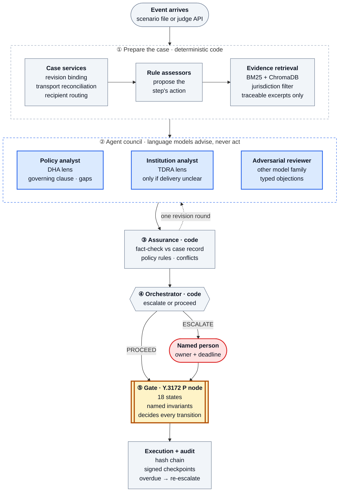

<sub>🟦 Blue = language models, which advise only · ⬜ grey = deterministic code · 🟨 amber = the gate, the only component that changes a case · 🟥 red = a named person. Dashed arrow = one revision round: assurance returns a flagged claim to its agent once.</sub>

<details>
<summary>Text version of the diagram</summary>

```
 event chunk  ── from a scenario file, or injected by a judge:  POST /api/runs/{id}/events
      │
      ▼
 DETERMINISTIC CASE SERVICES  revision binding · transport reconciliation · recipient routing · applicability
      │                       5 rule-based assessors propose the step's action
      ▼
 EVIDENCE RETRIEVAL  BM25 (+ ChromaDB via the ITU ingest) · jurisdiction filter · 96 traceable excerpts
      │
      ├─▶ ① POLICY EVIDENCE ANALYST   (LLM, DHA lens)   obligation status · governing clause · settled? · policy gap
      ├─▶ ② INSTITUTIONAL ANALYST     (LLM, TDRA lens)  only when transport is unresolved: does any telecom
      │                                                 clause cover delivery of this message to a person?
      └─▶ ③ ADVERSARIAL REVIEWER      (LLM, a different model family)  challenges each claim, reads the case
                                                        independently, raises a typed objection
      ▼
 ④ INDEPENDENT ASSURANCE (code)  fact check vs the case record · policy-rules check (a comparator can never
      │                          govern) · conflict detection · one feedback round: CORRECTED / UPHELD / DISPUTED
      ▼
 ⑤ DETERMINISTIC ORCHESTRATOR    PROCEED, or ESCALATE to a named owner with a deadline — on a verified
      │                          objection or a disputed claim. Gaps and differing readings are recorded.
      ▼
 GATE (P node, code)  18 states, named invariants — decides the transition; never reads the agents
      ▼
 EXECUTION & AUDIT    failed actions logged and escalated · overdue escalations re-escalated to tier 2 ·
                      every message, check and decision in a hash chain · HMAC-signed checkpoints
```

</details>

| Actor | Kind | Produces | Can it change the case? |
| :--- | :--- | :--- | :--- |
| ① Policy Evidence Analyst | LLM | obligation status, governing clause, "settled?", policy gap, rationale | No |
| ② Institutional analyst (TDRA) | LLM, conditional | whether a telecom clause covers this message | No |
| ③ Adversarial reviewer | LLM, independent model family | typed objection, own reading, per-claim support | No |
| ④ Assurance | code | fact/policy-rule findings; rejects objections the record contradicts | No |
| ⑤ Orchestrator | code | PROCEED or ESCALATE | Only an escalation to a person |
| Gate | code | the transition | **Yes — only this** |

Why this shape: in an earlier version an LLM "network agent" re-derived transport facts the system already
knew and **hallucinated delivery receipts**, and an LLM coordinator over-escalated and decided nothing a
rule could not; both were replaced by code. A reviewer from a different model family was kept because it
measurably caught more: with the critic on the same family as the agents it reviewed, 5 answers were
corrected; on a different family, 11 (same scenarios, one run each).

**Recorded run** — `python run_demo.py` replays it offline (Mistral `ministral-14b-2512` analysts, TypeSafe
Jev reviewer; synthetic cases only):

| | Result |
| :--- | :--- |
| Final state as expected | **8/8** scenarios |
| Decision points · agent answers · TDRA lens invoked | 25 · 58 · 8 |
| Analyst claims flagged by assurance | 22 → 7 corrected after feedback, 15 upheld, 0 disputed |
| Reviewer objections | 18 → 13 rejected by code (each contradicted the case record), 5 acted on |
| Steps tagged with a pre-registered policy gap | 19 (e.g. no acknowledgment clock, delivery evidence undefined) |
| Escalations raised by the agents | 5: S9 (the only one rules miss), and an unapproved fallback channel the gate also refuses (twice each in SC-02 and SC-07) |

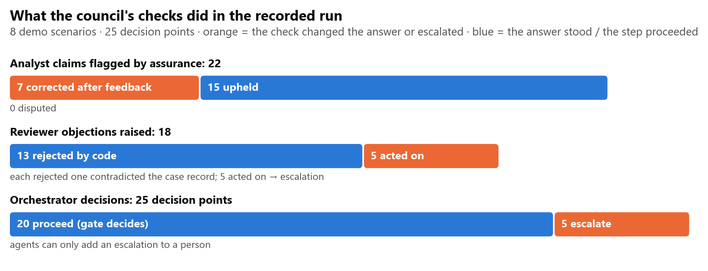

<sub>What the assurance checks did with the analysts' claims and the reviewer's objections, and what the orchestrator decided; read from evaluation/demo_run.json (regenerate with `python docs/figures/make_figures.py`).</sub>

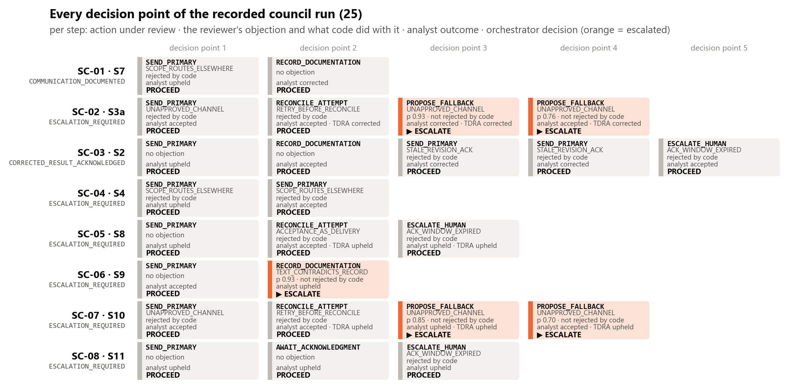

<sub>Every decision point of the recorded run: the action under review, the reviewer's objection and what code did with it, the analyst outcome, and the decision (orange = escalated).</sub>

**What the agents add that rules cannot (SC-06, scenario S9).** The SMS is delivered with a receipt and a
reply arrives from the registered number, marked as an acknowledgment from a verified number. The reply
says: *"This is his daughter. My father is in hospital abroad…"*. Rules read the structured fields and close
the case; the policy-blind baseline does too. The reviewer read the words, raised
`TEXT_CONTRADICTS_RECORD` (confidence 0.93), and the orchestrator escalated:

```console
   FINAL ESCALATION_REQUIRED   ✓ expected ESCALATION_REQUIRED
   policy-blind final → COMMUNICATION_DOCUMENTED · rules only (no agents) → COMMUNICATION_DOCUMENTED
           reviewer objection TEXT_CONTRADICTS_RECORD · own reading COMMUNICATED
           orchestrator ESCALATE ▶ verified reviewer objection TEXT_CONTRADICTS_RECORD
```

Said plainly: an earlier recording of this design missed S9 because one assurance rule rejected the
objection on a consistency heuristic (the reviewer named the same action as its "alternative"); that rule
was changed after seeing that run, so only checks against the case record can now reject an objection. The
recording above was made after the change and caught S9 on its own. Each figure above comes from a single
recorded run of a non-deterministic model.

**Is S9 a one-off? 60 live runs with twenty different replies** ([evaluation/s9_robustness.md](evaluation/s9_robustness.md)).
S9 was re-run live (Mistral `ministral-14b-2512` analysts, Jev reviewer), three runs per reply, with ten
replies that contradict the structured acknowledgment and ten genuine replies from the patient, English and
Arabic. Half of each group is deliberately hard: indirect wording ("Dad is asleep, I'll show him this in the
morning", "He doesn't use this phone anymore", an automatic out-of-office reply) and genuine replies that
mention family ("My wife is driving me to the clinic", "my daughter helped me read it", "ok").

| | Escalated by the council | 95% interval | Escalated by rules only |
| :--- | :---: | :---: | :---: |
| Reply contradicts the record (detection) | **28/30** (93%) | 79–98% | 0/30 |
| Genuine reply from the patient (false escalation) | **0/30** (0%) | 0–11% | 0/30 |

**The misses:** "Dad is asleep, I'll show him this in the morning" was caught in 1 of 3 runs. It never says
outright that the writer is not the patient; the same model at temperature 0 answered differently across
runs. Every other contradicting reply was caught 3/3, and no genuine reply was escalated.

Limits: twenty replies written by the team are a small sample, not an independent adversarial set (see
[docs/independent-review.md](docs/independent-review.md)); temperature 0, so repeats measure run-to-run
variation of the hosted models.

**One decision point, step by step** — SC-06 (scenario S9), action `RECORD_DOCUMENTATION`, as recorded in
[evaluation/demo_run.json](evaluation/demo_run.json):

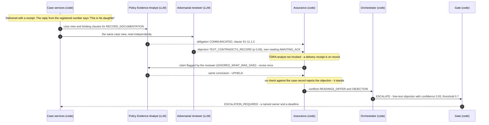

**Any model, per role.** Agents ask typed questions (named options or a probability); a chat model's JSON
answer is validated against them and anything off-list is rejected, never repaired. Every request passes the
residency guard first.

| `RESULTRELAY_AGENT_PROVIDER` | Endpoint | Residency (Federal Law 2/2019 Art. 13) |
| :--- | :--- | :--- |
| `ollama` | `http://localhost:11434/v1`, e.g. `qwen2.5:14b` (ITU reference model) | local: real cases allowed |
| `mistral` | `https://api.mistral.ai/v1` (`MISTRAL_API_KEY`) | outside the State: synthetic `SYN-*` cases only |
| `openai` | any OpenAI-compatible server (`RESULTRELAY_AGENT_URL`) | decided by the endpoint |
| `jev` | TypeSafe Jev (`TYPESAFE_API_KEY`) | outside the State: synthetic cases only |
| `replay` | recorded answers (default offline); refused if the case view changed | no request leaves the machine |

Each role can run on its own model with `RESULTRELAY_<ANALYST|INSTITUTION|REVIEWER>_PROVIDER` / `_MODEL`.
Recommended (and the recorded run):

```bash
RESULTRELAY_AGENT_PROVIDER=mistral
RESULTRELAY_AGENT_MODEL=ministral-14b-2512     # analysts; open weights, the size class of qwen2.5:14b
RESULTRELAY_REVIEWER_PROVIDER=jev              # the adversarial reviewer on a different model family
```

Keys go in `.env` at the repo root (git-ignored; see `.env.example`). The council runs in the
`resultrelay_council` configuration only, so the council-off configurations stay a clean comparison. On a
6 GB laptop a 3B local model ran but returned malformed answers and out-of-memory errors; the 14B reference
model needs the ITU Lab compute requested in [submission/DESIGN-BRIEF.md](submission/DESIGN-BRIEF.md).

## Architecture — ITU-T Y.3172, node for node

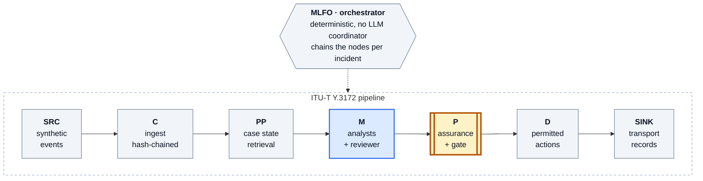

<sub>Node by node from [kb/framework/itu_y3172_mapping.csv](kb/framework/itu_y3172_mapping.csv), which also names the code, the test and the limitation for each node.</sub>

| Node (Y.3172 §8.1) | In ResultRelay | AI Readiness 2.0 dimension | Policy source |
| :--- | :--- | :--- | :--- |
| **SRC** | Synthetic result revisions, contacts, channels; the verified corpus | Data/Model Marketplace (1), Contextualization and Regional Impact (4) | DHA ST-28 §11.1 (walk-in tests) |
| **C** | Staged event streams: transport, patient and supervisor events | Level of Integration of AI in Workflows (5) | DHA ST-28 §11.1.1–3 |
| **PP** | Normalised states; report version, action id and provenance preserved | AI & Policies (10) | HL7 FHIR Task, IHE XDW (comparators) |
| **M** | Policy Evidence Analyst (DHA lens), conditional TDRA-lens analyst, adversarial reviewer (any LLM, per role); deterministic assurance | Collaboration with AI (8), Impacts of Humans in AI Integration (9) | DHA AI policy PP-09 §4.3.1, §4.4.2; UAE AI Charter |
| **P** | Gate: scope (§13.4 genetic results), version binding, reconcile-before-retry, no false closure | AI & Policies (10), Strategy Alignment (7) | DHA ST-28 §11.1, §13.4 |
| **D** | Mock transport that separates acceptance, delivery and acknowledgment; idempotency keys | Digital Infrastructure (13), Granular Priorities (12) | Federal Law 2/2019 Art. 4, 13; TDRA Mobile Spam §1-23 |
| **SINK** | Supervisor queue, React console, hash-chained audit re-verified on read | Human Interface (6), AI for Inclusion (11) | DHA ST-28 §11.1.3; NABIDH Audit Policy §3.2.10–11 |

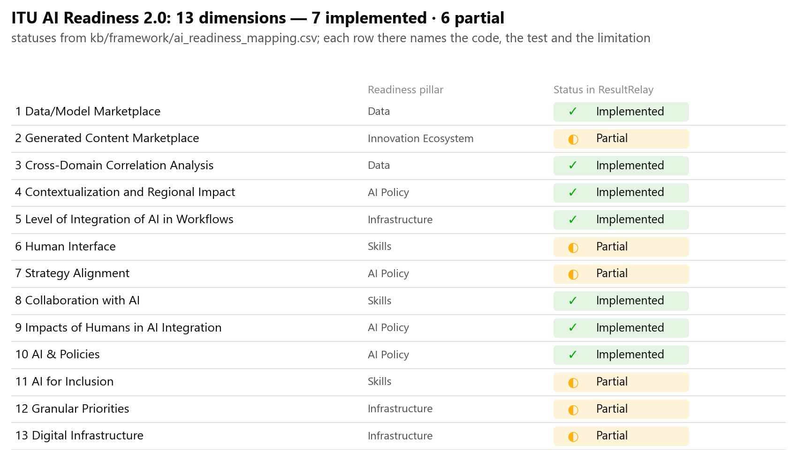

<sub>Each of the 13 ITU AI Readiness 2.0 dimensions and its status in ResultRelay, from kb/framework/ai_readiness_mapping.csv.</sub>

## The eight scenarios — `python run_demo.py`

> **Demo (8) vs evaluation (12).** `run_demo.py` walks through **eight headline scenarios** (SC-01 … SC-08) in one
> configuration, `resultrelay_council`, with a rules-only and policy-blind comparison. The **evaluation suite**
> (`scripts/run_evaluation.py`) runs **all twelve scenario files** in **twelve configurations** (144 runs). The
> demo set is a subset: SC-01…SC-08 = S7, S3a, S2, S4, S8, S9, S10, S11. S1 (ambiguous delivery), S3b (approved
> fallback procedure), S5 (late-acknowledgment race) and S6 (clause from another jurisdiction) are in the
> evaluation only.

| # | Scenario | Final state | Verdict | Rules only · policy-blind |
| :--- | :--- | :--- | :--- | :--- |
| **SC-01** normal | Genetic result routed to the referring physician | `COMMUNICATION_DOCUMENTED` | `COMPLIANT` | same · same |
| **SC-02** failure | Primary channel down, no approved fallback | `ESCALATION_REQUIRED` | `INSUFFICIENT_EVIDENCE` | same · invents a channel → `DELIVERY_CONFIRMED` |
| **SC-03** failure | Corrected result after acknowledgment of version 1 | `CORRECTED_RESULT_ACKNOWLEDGED` | `COMPLIANT` | same · `ESCALATION_REQUIRED` |
| **SC-04** controversial | Generic walk-in rule retrieved for a genetic result; no physician channel | `ESCALATION_REQUIRED` (failed send logged and escalated) | `VIOLATION` (prevented) | same · messages the patient |
| **SC-05** failure | Gateway accepts the SMS; no receipt ever arrives | `ESCALATION_REQUIRED` | `INSUFFICIENT_EVIDENCE` | same · records a delivery that never happened |
| **SC-06** agents | Delivered and "acknowledged", but the reply is from the patient's daughter | `ESCALATION_REQUIRED` | `INSUFFICIENT_EVIDENCE` | **closes the case** · closes the case |
| **SC-07** failure | Escalated to the supervisor, who never answers | `ESCALATION_REQUIRED` (raised to the clinical lead, tier 2) | `INSUFFICIENT_EVIDENCE` | same · records delivery |
| **SC-08** failure | Delivered with a receipt, never acknowledged | `ESCALATION_REQUIRED` (when the acknowledgment window passes) | `INSUFFICIENT_EVIDENCE` | same · same (a regression guard: it exposed a clock bug) |

**The case state machine** (main paths; [app/state_machine/transitions.py](app/state_machine/transitions.py)
is the full table). Transport states and human states are kept apart: no transport event can reach an
acknowledged or documented state.

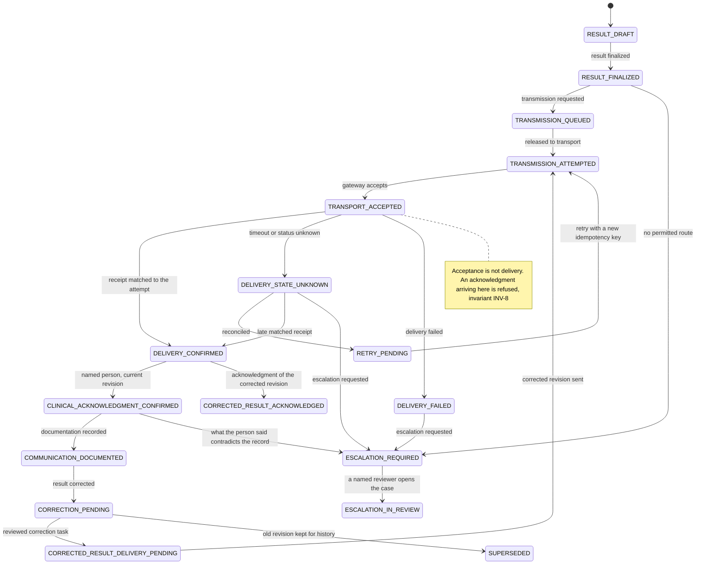

Every run prints the audit checkpoint; set `RESULTRELAY_AUDIT_KEY` to sign it (HMAC-SHA256 over the chain
head): a rebuilt, internally consistent chain passes the hash check but not the signed checkpoint.
`python scripts/timestamp_audit.py S8-accepted-never-delivered` anchors a checkpoint in time with an RFC 3161
token from an independent Time-Stamping Authority (FreeTSA by default; only the hash leaves the machine) —
example in `evaluation/timestamps/`. The console's decision trace shows the council at each step: each
agent's answers and rationale, assurance outcomes, and the orchestrator's decision.

## Where the scenarios come from

The scenarios are **synthetic adaptations of published patient-safety incidents** and clinical-workflow studies:
the failure mode is taken from the published case, the facts, names and timings are invented, and the
source is cited as provenance in each scenario file (`"provenance"`), not reproduced.

| Scenario | Failure mode in the published case | Match | Source |
| :--- | :--- | :--- | :--- |
| S1 | notification reached a device or intermediary; the responsible person never acknowledged | strong | [AHRQ PSNet WebM&M (2017)](https://psnet.ahrq.gov/web-mm/delayed-recognition-positive-blood-culture) · [BMJ Open Quality (2021)](https://pmc.ncbi.nlm.nih.gov/articles/PMC8442100/) |
| S8 | outgoing notification counted as done; acknowledgment by a person absent | strong | [BMJ Open Quality (2021)](https://pmc.ncbi.nlm.nih.gov/articles/PMC8442100/) · [AHRQ PSNet WebM&M (2017)](https://psnet.ahrq.gov/web-mm/delayed-recognition-positive-blood-culture) |
| S9 | a relative receives or answers for the patient; consent and identity decide, not the phone number | very strong | [Medical Protection Asia Casebook, July 2017, Case 2](https://www.medicalprotection.org/docs/medicalprotectioninternationallibraries/pdfs/casebook-pdfs/asia-casebook-pdfs/july-2017.pdf) · [Medical Protection](https://www.medicalprotection.org/uk/articles/digital-dilemmas-communicating-with-patients-by-text) |
| S11 | a notification reached a device or intermediary; the responsible person never acknowledged | strong | [AHRQ PSNet WebM&M (2017)](https://psnet.ahrq.gov/web-mm/delayed-recognition-positive-blood-culture) · [BMJ Open Quality (2021)](https://pmc.ncbi.nlm.nih.gov/articles/PMC8442100/) |
| S10 | the attending was paged and did not respond; nobody escalated further | almost exact | [CRICO / Harvard Risk Management Foundation (2023)](https://rmfcd1-prod.rmf.harvard.edu/Risk-Prevention-and-Education/Case-Study-Catalog-Page/Case-Study/2023/Discharged-Patient-with-Pending-Test-Results) |
| S2 | an amended result reached a unit, not the clinician who had acted on the first version | almost exact | [AHRQ PSNet WebM&M (2012)](https://psnet.ahrq.gov/web-mm/amended-lab-results-communication-slip) |
| S5 | an acknowledgment that belongs to an earlier version must not close the amended one | related | [AHRQ PSNet WebM&M (2012)](https://psnet.ahrq.gov/web-mm/amended-lab-results-communication-slip) |
| S3a | the intended recipient could not be reached and no escalation path was followed | almost exact | [CRICO / Harvard Risk Management Foundation (2023)](https://rmfcd1-prod.rmf.harvard.edu/Risk-Prevention-and-Education/Case-Study-Catalog-Page/Case-Study/2023/Discharged-Patient-with-Pending-Test-Results) · [American Journal of Clinical Pathology (2011)](https://pmc.ncbi.nlm.nih.gov/articles/PMC7065418/) |
| S3b | an approved escalation path (on-call pathologist) reaches a responsible clinician | close | [American Journal of Clinical Pathology (2011)](https://pmc.ncbi.nlm.nih.gov/articles/PMC7065418/) |
| S4 | genetic results need consent-aware routing and counselling | related, not exact | [Adverse events in genetic testing](https://pubmed.ncbi.nlm.nih.gov/31335384/) · [Illustrative case studies in the return of exome and genome sequencing results (2015, PMC4607287)](https://pmc.ncbi.nlm.nih.gov/articles/PMC4607287/) |
| S7 | who receives a genetic result is planned in advance, not decided by the channel | related, not exact | [Illustrative case studies in the return of exome and genome sequencing results (2015, PMC4607287)](https://pmc.ncbi.nlm.nih.gov/articles/PMC4607287/) · [Adverse events in genetic testing](https://pubmed.ncbi.nlm.nih.gov/31335384/) |

S6 (a clause from another jurisdiction) has no incident source: it tests the applicability filter. The
genetic-routing sources show that genetic results need consent-aware, planned routing; they do not establish
that every genetic result must go to a particular specialist — that routing comes from DHA ST-28 §13.4.

## Evaluation — `python scripts/run_evaluation.py`

12 scenarios × 12 configurations = 144 runs. *Fully safe* = every must-hold assertion passed **and** the case
ended in a state its expectation allows (assertions alone had scored a case closed on the daughter's reply
as safe).

> **What the 144 runs are, and are not.** They are 144 deterministic scenario × configuration runs. Only the
> `resultrelay_council` column involves language models, and it **replays one recorded live run** (providers
> `replay:recorded-mistral`, `replay:recorded-jev`), so that anyone can reproduce it offline. They are **not**
> 144 independent model experiments. Evidence about model reliability comes from the separate, live
> [S9 robustness study](evaluation/s9_robustness.md) (below).

| Configuration | Fully safe | Assertions | Provenance |
| :--- | ---: | ---: | ---: |
| `resultrelay_council` (rules + agent council) | **12/12** | **53/53** | 1.00 |
| `resultrelay` (rules, no agents) | 11/12 — misses S9 | 53/53 | 1.00 |
| `static_rules` (competent hand-written rules, genetic rule hard-coded) | 11/12 — misses S9 | 53/53 | 0.00 |
| `ablate_no_applicability_filter` | 10/12 | 52/53 | 1.00 |
| `ablate_no_kb` · `ablate_ack_any` · `ablate_optimistic_transport` | 9/12 | 51/53 | 0.00–1.00 |
| `ablate_no_invariants` | 8/12 | 51/53 | 1.00 |
| `retrieval_only` | 4/12 | 46/53 | 1.00 |
| `policy_blind` | 3/12 | 45/53 | 0.00 |

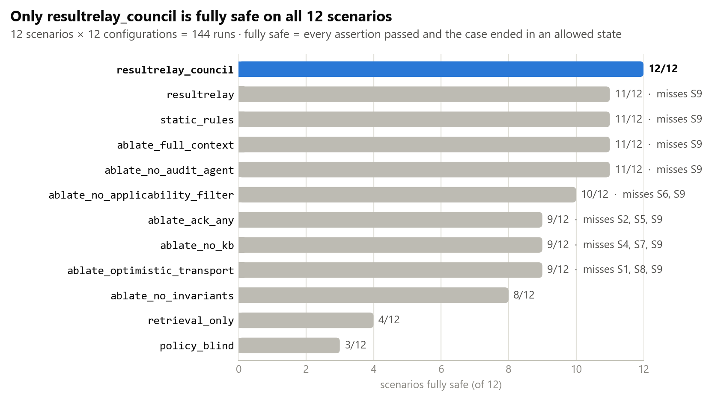

<sub>Fully safe scenarios per configuration, read from evaluation/results/latest.json (regenerate with `python docs/figures/make_figures.py`).</sub>

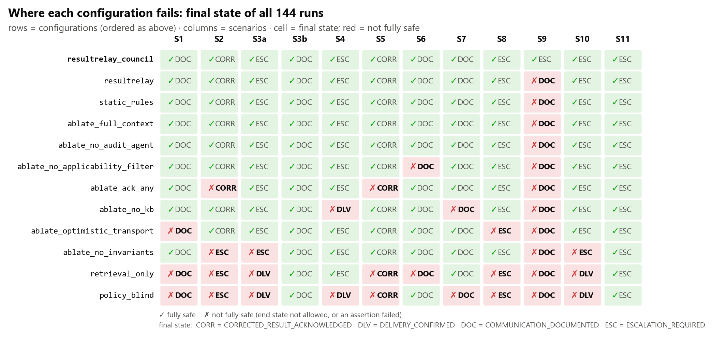

<sub>Every run of the matrix: the final state each configuration reached on each scenario; red = not fully safe.</sub>

S11 exposed a real bug: delivery time and the scenario clock used different units, so a delivered-but-never-
acknowledged result was never escalated; fixed, and S11 now guards it.

What this shows, and does not: a competent rules engine with the same state machine is as safe as
ResultRelay's rules on structured events — ResultRelay's added value there is **provenance** (every
decision cites a verified clause; 1.00 vs 0.00) and jurisdiction gating. The agents add the one case rules
cannot read (S9). `ablate_no_audit_agent` and `ablate_full_context` are **controls**: they cannot change an
outcome by construction and score 11/12 like `resultrelay`. All scenarios and expectations were written by
the team that wrote the engine (each file says so); the council figures come from one recorded run, and S9
was repeated live 60 times with twenty reply variants (28/30 detected, 0/30 false escalations). DHA's
AI policy (PP-09 §4.3.3) requires independent third-party validation; this system has had none. A two-hour
protocol for one outside reviewer (check the 12 expected outcomes, write held-out cases, try to fool the reply
reader) is in [docs/independent-review.md](docs/independent-review.md).

## Knowledge base — `GET /api/kb/search?q=…&jurisdiction=AE-DU`

**96 traceable excerpts from 24 policy and standards documents**, each with issuing body, jurisdiction, section, printed page and a
claim class; only `BINDING_REQUIREMENT` can block an action, and only sources that bind the case
jurisdiction carry it. **74 are verified against official downloads** (PDF, eCFR, ETSI, WIPO Lex, Dubai Legal Portal); **2 against a mirror** (the PDPL's unofficial English translation) (the quote must appear on the
declared page, or the excerpt is rejected and never indexed); **7 against third-party copies** (TDRA Mobile Spam policy; EU AI Act articles) because the official sites refuse scripted clients; **13 (Federal Law 2/2019,
UAE AI Charter, ADHICS) against recorded transcriptions** of portal pages. The served index is pinned by
SHA-256 and re-checked on load.

| Layer | Sources |
| :--- | :--- |
| Dubai (binding) | DHA establishment law (Law No. 6 of 2018 as amended, Art. 5–6: DHA's mandate) · DHA ST-28 laboratory standards · DHA AI in Healthcare policy PP-09 · NABIDH Audit Policy · DHA health-information and data-quality policies |
| Federal | Federal Law 2/2019 (ICT in health) · Telecom Law (Decree-Law 3/2003, Art. 13: TDRA's mandate) · PDPL (scope exclusion only) · UAE AI Charter · TDRA Mobile Spam policy |
| Comparators | DoH Abu Dhabi lab standard and ADHICS · RCPath G158 (UK) · US CLIA 42 CFR 493.1291 · EU AI Act Arts 14/26/73 · Saudi PDPL (GCC) · ETSI TS 123 040 (3GPP SMS) · Joint Commission NPSG · ONC SAFER Guide 8 · HL7 FHIR R5 Task · IHE XDW · ITU-T Y.3172 · ITU AI Readiness 2.0 |

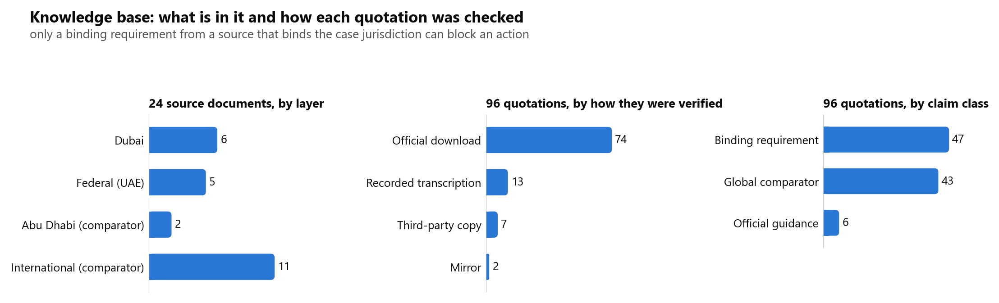

<sub>Sources by layer (kb/source_register.csv); quotations by verification class and by claim class (kb/index/chunks.json).</sub>

**Vector KB built with the ITU reference code — shipped in `kb/chroma`.** `python scripts/export_itu_kb.py
--ingest PATH/TO/ITUAIReadiness` writes every excerpt to `kb/itu_inputdocs/` in the ITU InputDocs
format and runs the ITU `ingest.py` (Ollama `nomic-embed-text`, ChromaDB, cosine), with clause id, authority,
jurisdiction, section, page and URL as metadata. **The search API is hybrid by default** (BM25 fused with the vector
ranking); it falls back to BM25 with a note when Ollama is not running. The vector store only *ranks*: text
always comes from the checked, SHA-pinned index.

**Which retrieval drives decisions.** The vector index is part of the ITU-compatible retrieval stack and
serves the search API and the console. Everything that feeds a decision, the rule assessors and the agent
council, uses deterministic **BM25** (`engine="bm25"` in `app/multiagent/council.py`,
`app/agents/policy_applicability.py`, `app/agents/lab_workflow.py`), so the recorded agent answers, the demo
and the 144-run evaluation replay exactly on any machine, with or without Ollama. No decision in the
recorded results was driven by vector search; hybrid retrieval is available separately.

On seven plain-language questions ([evaluation/retrieval_check.md](evaluation/retrieval_check.md)) the
expected clause is in the top 5 for **hybrid 4/7, BM25 1/7**; Arabic questions are mapped to the English
clauses ("نقل البيانات الصحية خارج الدولة" → Law 2/2019 Art. 13 first). The questions are ours: a smoke test.

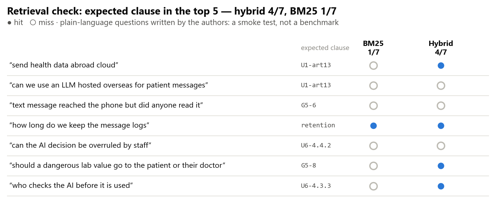

<sub>The seven questions of evaluation/retrieval_check.md: expected clause in the top 5, BM25 against hybrid retrieval.</sub>

**Sources a script cannot download** — the UAE National Strategy for AI 2031, Ministerial Resolution 51/2021,
the National Cybersecurity Strategy, a MOHAP health-AI instrument, and the official texts behind the
transcriptions — are listed with official links and the steps to add them in
[kb/sources/MANUAL_RETRIEVAL.md](kb/sources/MANUAL_RETRIEVAL.md).

## Policy and standards gaps — [kb/gap_register.csv](kb/gap_register.csv)

| Gap | Type | Global comparison |
| :--- | :--- | :--- |
| **GR-15** TDRA's policy defines "delivery" only for marketing SMS, as network delivery to the subscriber (§1-23, §8-1); DHA ST-28 §11.1.3 needs a record of communication. Nothing joins them, or assigns responsibility for an accepted-but-lost clinical SMS | Coordination (health ↔ telecom) | ETSI TS 123 040 §9.2.3.15: SMS status stops at "received by the SME" (the receiving entity: a handset or application, not a person); RCPath G158 §5 (UK): feedback on "received, read, understood" |
| **GR-16** DHA ST-28 §11.1 provides for walk-in results to the patient, with no acknowledgment standard for a lay recipient of a critical value | Conflict between objectives | RCPath G158 §8: critical results "only communicated with the requesting clinical team" |
| **GR-11** Is the communication record an audit log (NABIDH §3.2.11: 3 years) or health data (Law 2/2019 Art. 20: 25 years)? | Standards ambiguity | RCPath G158 §7 names the record's fields, leaves retention local |
| **GR-17** DHA PP-09 requires agreed accountability, independent validation and AI-incident reporting, but names no default owner, validator or deadline; its revision date (1 July 2026) has passed | AI governance | EU AI Act Art. 26(2) requires deployers to assign oversight to competent persons; Art. 73(2) sets a 15-day serious-incident deadline |
| **GR-03** No retrieved source sets an acknowledgment clock for walk-in results | Unclear responsibility | Joint Commission NPSG.02.03.01 leaves the time frame to the organisation |
| **GR-18** No route for a clinical SMS to show it is not marketing (quiet hours 9pm–7am, §8-3) | Implementation | none retrieved |
| **GR-19** The exceptions to the UAE ban on processing health data abroad sit in Ministerial Resolution 51/2021, which no official portal served | AI governance / residency | Saudi PDPL Art. 29: lists transfer purposes in the law and delegates the rest, and the adequacy test, to Regulations (GCC) |

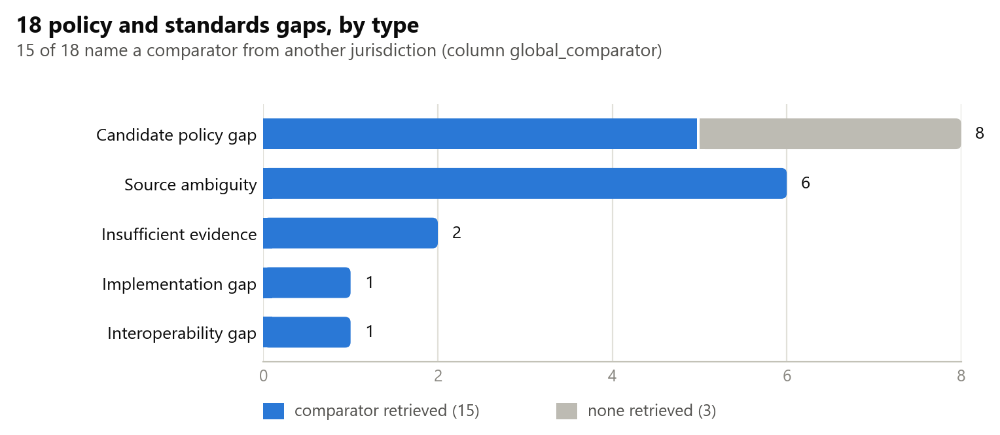

<sub>All entries of kb/gap_register.csv by type, and whether a comparator from another jurisdiction was retrieved.</sub>

18 entries in total; each lists the sources reviewed, what they establish, what remains unclear and the
product control that follows. Gaps that rest on an absence say what was searched (the full corpus, 2 Nov 2026):
an absence cannot be proven, only searched for. PDPL (Federal Decree-Law
45/2021) is cited only for its scope exclusion: **Article 2, exclusion (e)** — health data governed by
its own legislation.

## Run it

```bash
python -m pip install -r requirements.txt
python -m pytest -q                          # 258 tests (one skips unless every source text is cached)
python run_demo.py                           # DEMO: 8 headline scenarios (SC-01…SC-08); the council replays recorded answers offline
python scripts/run_evaluation.py             # EVALUATION: all 12 scenarios × 12 configurations = 144 runs → evaluation/report.md
python scripts/s9_robustness.py --repeats 3  # optional, live models: 20 reply variants of S9 → evaluation/s9_robustness.md
python scripts/smoke_api.py                  # API smoke test (also run by CI): S9 through the API with the council
python -m uvicorn app.main:app --port 8000   # API + built UI on http://127.0.0.1:8000  (docs at /api/docs)
python scripts/fetch_sources.py              # optional: download the official texts and re-verify every quote

# optional: vector KB with the ITU reference stack (pip install -r requirements-itu.txt; Ollama running)
ollama pull nomic-embed-text
python scripts/export_itu_kb.py --ingest PATH/TO/ITUAIReadiness
RESULTRELAY_RETRIEVAL=hybrid python scripts/retrieval_check.py
```

Live adviser: set `TYPESAFE_API_KEY` and `RESULTRELAY_ADVISE=1`, `RESULTRELAY_ADVISE_PROVIDER=jev`
(PowerShell: `$env:RESULTRELAY_ADVISE='1'`). A local OpenAI-compatible model (Ollama) works through
`RESULTRELAY_ADVISE_URL=http://localhost:11434/v1`. The UI is pre-built in `app/static/app`; rebuild with
`cd web && npm ci && npm run build`. Authentication is off by default (set `RESULTRELAY_API_KEY` to require an `X-API-Key` header): bind to 127.0.0.1 and use synthetic
data only.

## Repository

```
app/          gateway: agents/, multiagent/ (council, providers), advisers/ (guard, residency), orchestration/ (gate, engine),
              state_machine/, transport/, kb/ (ingest + verified retrieval), audit/, api/, static/ (built UI)
web/          React console (CaseTimeline, Simulator, Standards & gaps, Evaluation, Audit, Decision trace)
kb/           records/ (checked excerpts) · index/ (pinned) · framework/ (Y.3172 + Readiness mappings) · itu_inputdocs/
scenarios/    S1–S11 (12 files) staged event streams · expected/ (assertions)
evaluation/   report.md · results/latest.json · agent_runs/ (recorded adviser responses)
submission/   technical report · design brief · build scripts
docs/         architecture, REPORT, audit disposition, design notes
tests/        258 tests
```

## License

[MIT](LICENSE). Source documents belong to their issuing bodies and are not redistributed; quotations are
minimal and attributed with section and page.
